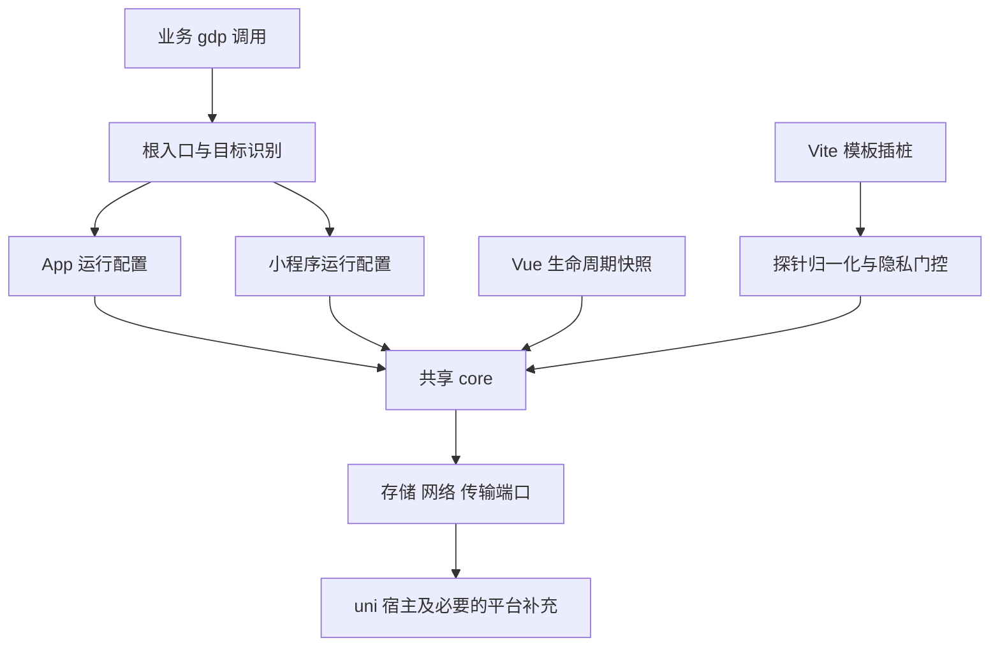

# uni-app 小程序平台支持调研与开发方案

> 调研日期：2026-10-27。当前仓库：`minp` 分支，`1ec311b`，SDK `0.1.0`。
>
> 状态：八端基础采集代码与专项自动化已实现，开发者工具交互及真机收数按约定后补。当前接入和验证命令见[小程序接入](./miniprogram.md)，当前结果见[八端验证记录](./miniprogram-platforms-validation-2026-10-27.md)。下文保留扩展前调研与完整分批方案。
>
> 后续扩展：identify / forceLogin、旧身份迁移、内嵌 H5 与原生扩展的 JS SDK 也已实现，见[扩展接入说明](./advanced-identity-hybrid.md)；下文基础交付的排除项保留其原始分期含义。

建议在现有 SDK 中增加小程序运行配置，复用核心事件链和 Vue 模板插桩，按平台补齐协议、生命周期、会话、存储及上传策略。交付顺序建议为微信与支付宝，再扩展百度、抖音、QQ、快手，最后完成京东与小红书的端侧验收。

本次已验证现有 SDK 源码与部分模板探针可以编译到上述八个平台，同时复现了小程序被识别为 App、`appId` 被剥离和小程序协议值被拒绝的问题。因此，编译通过可以作为复用的依据，不能作为平台支持已经完成的依据。

## 扩展前调研基线

### 扩展前的实现范围

| 检查项 | 当前行为 | 小程序开发需要补齐的内容 |
| --- | --- | --- |
| 根入口 | `index.ts` 固定调用 `createAppTracker`，从 `globalThis.uni` 获取宿主 | 区分 App 与各小程序目标；验证编译器注入的 `uni` 与全局对象的关系 |
| 系统类型 | `AppPlatform` 仅有 Android、iOS、HarmonyOS | 独立的小程序目标与系统上下文，避免把宿主平台和操作系统混在一起 |
| 平台识别 | `AppSystemContextPort` 读取 `device.platform` 或 `system.platform` | 根据构建目标和 `uniPlatform` 选择运行配置 |
| 宿主前置检查 | 必须存在 `getDeviceInfo`、`getAppBaseInfo` 等全部 App 方法 | 按平台检查必要能力，对可选系统接口提供回退 |
| 初始化配置 | `appId` 仅为预留输入，不进入归一化配置 | 校验、保存真实小程序 appId，用于 `domain` 和存储隔离 |
| 协议校验 | `buildAppEvent` 只接受三个 App 平台和 App 设备类型 | 为小程序提供独立字段白名单、枚举和必填规则 |
| App 与页面桥接 | Vue mixin、`$mpType`、`$page.route`、`__route__`、App 路由元数据 | 验证小程序页面形态、初始生命周期时机、标题和前后台顺序 |
| 会话 | App 默认退后台超过 30 秒换会话，保存会话快照 | 小程序保活、场景变化及仅内存会话策略 |
| 队列与上传 | App 队列持久化；入队即具备发送资格；最多三个并发请求 | 小程序有界内存队列及批量节流 |
| 无埋点 | Vue SFC AST 插桩和 runtime dispatcher 已存在 | 实际事件对象、dataset、组件语义及逐平台能力门控 |
| 能力声明 | 生产能力表只有 App 三端；uni_modules 元数据声明 `mp.weixin = x` | 随验收结果逐项更新小程序能力与交付声明 |
| 测试与 demo | 现有用例和 demo 围绕 App 设计 | 专属小程序 fixture、编译工程、开发者工具和真机验收 |

源码依据：[根入口](../index.ts)、[运行时装配](../src/platform/index.ts)、[系统适配](../src/platform/system.ts)、[公共类型](../src/types/index.ts)、[配置](../src/constants/config.ts)、[协议](../src/core/dataStore/protocol.ts)、[生命周期桥接](../src/adapters/uniapp.ts)、[能力表](../src/constants/platform.ts)、[构建声明](../scripts/build-sdk.ts)。

三个最小复现结果如下，均直接调用当前源码，未修改实现：

| 输入 | 实际结果 |
| --- | --- |
| `platform: android`，同时提供 `uniPlatform: mp-weixin` | 系统适配结果仍为 `platform: Android`，`domain` 为空 |
| 合法初始化参数中提供 `appId: wx-fixture` | 归一化后的配置没有 `appId` |
| 使用完整公共字段构建 `platform: MinP` 的 `VISIT` | 返回 `invalid_field_value` |

小程序可能在开发者工具中因 `platform: devtools` 被拒绝，又在手机上因 `platform: android/ios` 被误识别。后一项是根据当前识别规则作出的推断，不能以手机上初始化未报错判定支持成功。

### 已有小程序 SDK 可提供的参考

本机独立小程序 SDK 位于 `gio-miniprogram-autotracker`，本次检查版本为 `develop4.0 / 0107c9d7`，工作区干净。其源码已经包含微信、支付宝、百度、抖音、QQ、快手、京东和小红书的 framework 平台配置，以及 uni-app Vue 2／Vue 3 适配器。README 的“7 大平台”介绍不能代替当前源码矩阵，也不能证明所有框架和设备已经验收。

适合复用的是字段映射、场景归一化、入口与页面上下文规则、保活逻辑和请求差异；复用时转成当前仓库的契约和测试，不直接把另一套 SDK 装入当前 runtime。独立 SDK 还具有分享、曝光、多实例等本仓库未交付能力，这些能力需要单独立项。

主要参考源码：[平台配置](../../gio-miniprogram-autotracker/src/platformConfig/framework.ts)、[上报上下文](../../gio-miniprogram-autotracker/src/core/dataStore/eventContextBuilder.ts)、[App 生命周期](../../gio-miniprogram-autotracker/src/core/dataStore/eventHooks/appEffects.ts)、[页面上下文](../../gio-miniprogram-autotracker/src/core/dataStore/eventHooks/minipPage.ts)、[会话](../../gio-miniprogram-autotracker/src/core/userStore.ts)、[上传器](../../gio-miniprogram-autotracker/src/core/uploader.ts)、[uni-app 适配](../../gio-miniprogram-autotracker/src/adapters/gioUniAppAdapter.ts)。这些链接指向本机兄弟仓库。

### 本次验证结果

| 验证层级 | 结果 | 能说明什么 |
| --- | --- | --- |
| 当前源码类型检查 | `pnpm run typecheck` 通过 | 当前 TypeScript 基线有效 |
| 当前自动化测试 | 63 个文件、702 项用例全部通过 | 当前已有行为的回归基线有效；这些不是新增的小程序验收用例 |
| 八个平台隔离编译 | 全部通过 | 当前源码及所选模板探针可以被该版本工具链编译 |
| 小程序运行与真实收数 | 本次未执行 | 页面识别、事件对象、请求及服务端归档仍需后续验证 |

隔离编译使用本机 HBuilderX 的 `uniapp-cli-vite 5.26.2026091411.1611`，DCloud 包版本 `3.0.0-alpha-5020520260821001`，Vue `3.4.21`。最小工程包含当前 `index.ts`、`autotrack.ts`，以及经过现有 `transformAutoTrackSfc` 处理的 `.vue` 页面，覆盖按钮 tap、input blur 与 v-model、静态 picker、v-for、动态 dataset。产物中可见微信的 `bindtap/bindblur` 和支付宝的 `onTap/onBlur` 及对应探针。

本仓库开发依赖中的 Vite 插件为 `3.0.0-5020420260812001`，与此次 HBuilderX 编译包不同。实施时必须分别固定 CLI 与 HBuilderX 版本并验证，两者的结论不能互相替代。生成的调研记录保存在 `test-results/miniprogram-research-2026-10-27/`，该目录按仓库规则不提交。

## 目标平台和功能范围

### 平台交付顺序

下表的 wire platform 来自独立小程序 SDK 的实际配置。它表示建议兼容的上报值，阶段零需要先将这些值补入本仓库的主协议，并完成对应契约。

| 平台 | uni-app 目标 | 建议 wire platform | 本次最小工程编译 | 交付批次 |
| --- | --- | --- | --- | --- |
| 微信 | `mp-weixin` | `MinP` | 通过 | 第一批 |
| 支付宝 | `mp-alipay` | `alip` | 通过 | 第一批 |
| 百度 | `mp-baidu` | `baidup` | 通过 | 第二批 |
| 抖音及其关联宿主 | `mp-toutiao` | `bytedance` | 通过 | 第二批 |
| QQ | `mp-qq` | `qq` | 通过 | 第二批 |
| 快手 | `mp-kuaishou` | `kuaishoup` | 通过 | 第二批 |
| 京东 | `mp-jd` | `jdp` | 通过 | 第三批 |
| 小红书 | `mp-xhs` | `xhsp` | 通过 | 第三批 |

第一批选择微信和支付宝，是为了用两种差异明显的宿主实现尽早验证公共设计，建立后续扩端基线。该顺序是本方案的工程建议，可按实际客户需求调整。

DCloud 文档还列出飞书、360、鸿蒙元服务等条件编译目标。框架列出一个目标，不等于当前 SDK 已有对应协议或实际可用的编译链。飞书、钉钉、360、鸿蒙元服务、快应用，以及淘宝／天猫等生态暂列后续评估，不套用支付宝或抖音的配置来宣称支持。[DCloud 条件编译](https://uniapp.dcloud.net.cn/tutorial/platform.html)

本方案针对传统 uni-app Vue 3 `.vue` 项目。原生小程序项目继续使用独立小程序 SDK；Vue 2、uni-app x、`.nvue` 和 Web 不随本次扩端一起交付。原生宿主加载 `.wgt` 的 uniMP 是另一条路线，继续遵循[原生宿主打通设计](./unimp-native-hybrid-design.md)，不依赖本方案。

### 每个平台的基础交付能力

- 保持现有 `gdp()` 入口和插件注册方式，提供手动事件、用户身份、用户属性、位置设置和采集开关。
- 自动维护 App／Page 生命周期，生成 `VISIT`、`PAGE`；关闭事件按各平台最终契约和验收结果开放。
- 提供匿名身份和全局事件序号持久化、有界内存事件队列、批量发送及有限重试。
- `gioEventAutoTracking` 继续作为显式注册的内置插件，逐平台、逐组件开放点击、输入完成、选择器和 tabBar 采集。
- 同时验证 npm 与 uni_modules 安装，交付平台矩阵、接入说明和真实收数记录。

分享链路、曝光、原生增强、ABTest、多实例、事件计时器、`identify`／`forceLogin`、内嵌 H5 身份打通不在基础交付范围内。旧小程序 SDK 用户迁移时必须对照命令与插件清单，不能承诺直接替换后全部功能等价。

## 技术路线

| 路线 | 收益 | 代价 | 结论 |
| --- | --- | --- | --- |
| 在当前入口内转接完整独立小程序 SDK | 已有能力较多，短期接入较快 | 两套配置、状态、插件和发布体系；自动事件及全局入口容易冲突 | 适合独立 SDK 接入，不作为当前仓库的默认方案 |
| 共享现有 core，新增小程序运行配置 | 统一业务入口，保留已有测试和安全规则，差异集中管理 | 需要拆出当前 App 专有的协议、会话和调度假设 | 推荐 |
| 为各平台分别复制当前 SDK | 单个平台改动直观 | 修复需要多处同步，协议和隐私规则容易分叉 | 不采用 |

保留现有端口作为宿主调用的替换位置，增加 App 与小程序之间真实存在的策略差异。身份、属性归一化、序号、有界队列、请求唯一结算、重试和隐私规则继续只有一套实现。



### 平台识别和宿主装配

SDK 内部独立保存三个概念：构建目标，例如 `mp-weixin`；协议平台，例如 `MinP`；设备操作系统，例如 Android。`AppPlatform` 继续专用于 App，不直接把小程序值加入现有 App 联合类型。

建议识别顺序为：已被 uni 构建系统静态替换的目标值或 SDK 编译插件注入值，其次为宿主的 `uniPlatform`，最后仅在必要时读取平台专属能力作校验。编译目标与运行信息明确冲突时拒绝初始化；目标缺失时不得仅凭 Android／iOS 猜成 App，也不得默认猜成微信。运行时代码不能依赖 Node 的 `process` 对象。

官方将 `uniPlatform` 定义为 uni-app 运行平台；`getAppBaseInfo().appId` 是 DCloud appid，`hostVersion` 是微信等宿主版本。它们与设备操作系统、真实小程序 appId 是不同字段。[系统信息概念](https://uniapp.dcloud.net.cn/api/system/info)、[getAppBaseInfo](https://uniapp.dcloud.net.cn/api/system/getAppBaseInfo.html)

宿主读取集中放在 `src/platform`。`uni.request`、`uni.*StorageSync`、网络接口优先复用，必要的 `wx`／`my`／其他宿主调用只在对应适配文件内出现。不要将支付宝原生 `my.request` 的 `headers` 参数误传给统一的 `uni.request`；只有绕过 uni 的补充实现才处理这种差异。

`getDeviceInfo`、`getAppBaseInfo`、`getWindowInfo` 均按存在性和目标能力判断后调用，不能作为所有小程序的统一初始化前置条件。微信优先使用拆分系统接口，其他目标根据固定版本能力回退到可用接口。官方兼容表对这些接口的各端支持并不一致。[getDeviceInfo](https://uniapp.dcloud.net.cn/api/system/getDeviceInfo.html)、[getAppBaseInfo](https://uniapp.dcloud.net.cn/api/system/getAppBaseInfo.html)、[getWindowInfo](https://uniapp.dcloud.net.cn/api/system/getWindowInfo.html)

## 对外接入和配置

保留现有安装入口，不要求使用方再安装 `gioUniAppAdapter`。只使用手动事件和基础生命周期的工程也必须能够初始化，不能强制依赖模板插桩插件。

以下接入形式已在八端实现：

```ts
import gdp from 'gio-uniapp-autotracker'

export function createApp() {
  const app = createSSRApp(App)
  gdp('registerPlugins', [{ name: 'gioEventAutoTracking' }])
  gdp('init', 'account-id', 'data-source-id', {
    uniVue: app,
    appId: '平台分配的真实小程序 appId',
    appVersion: '1.0.0',
    dataCollect: false,
    keepAlive: 5,
    uploadInterval: 1000,
  })
  return { app }
}
```

无埋点仍按当前接入说明，在 `uni()` 之前安装 `gioUniappAutoTrack()`；同一个应用只加载一份 SDK。

| 配置 | 小程序建议契约 | App 兼容要求 |
| --- | --- | --- |
| `appId` | 必须为非空真实平台 appId；可读取真实 appId 的平台用于交叉校验，冲突时失败 | 继续沿用当前不消费该字段的行为 |
| `appVersion` | 优先显式配置；其次使用可用的正式版小程序版本；均缺失时诊断并省略，不用宿主版本或默认版本冒充；阶段零补充该降级契约 | 保持安装包版本优先的现有逻辑 |
| `keepAlive` | 新增，仅小程序消费，单位分钟，建议默认 5，有限正数 | 不改变 App 的会话默认值 |
| `sessionExpires` | 小程序仅接受 `-1` 或有限正数；默认 `-1` 表示关闭额外的活动超时，启用时沿用独立 SDK 的活动超时语义 | 保持当前有限正数校验及默认 0.5 分钟的后台超时语义 |
| `uploadInterval` | 新增，仅小程序消费，单位毫秒，建议默认 1000，有限正数 | 保持 App 的即时调度 |
| `appChannel` | 小程序由场景值生成，业务配置不覆盖真实 scene | 继续使用现有 App 配置 |
| `dataCollect`、`idMapping`、`debug` | 保持当前公开语义 | 不扩大运行期可修改配置范围 |

配置按已识别的运行配置归一化，明确区分 App 和小程序内部结果；不得把相同名称的 `sessionExpires` 无条件套入现有 App 状态机。App 输入新增的小程序专属字段时不消费、不上报，并在调试诊断中明确其不适用。

`uni.getAccountInfoSync()` 的兼容表支持微信、支付宝等目标，但百度、抖音等并非全部支持，因此不能把自动读取 appId 作为唯一来源。DCloud 的 `__UNI__...`、accountId、dataSourceId 均不能代替真实小程序 appId。[账号信息](https://uniapp.dcloud.io/api/other/getAccountInfoSync.html)

## 协议适配

### 先修订主协议

[Measurement Protocol](./measurement-protocol.md) 仍是唯一字段来源。本次已明确微信 `MinP`、支付宝 `alip`、VISIT 外部来源及两端关闭事件，并建立独立小程序字段校验。其余平台扩展时仍需先明确对应差异并修订契约，不能直接放宽 App 字段。

建议保留各平台既有 wire platform；保留入口来源的合法表达；关闭事件按已明确的目标列表开放。若服务端对某个平台的约定不同，以确认后的主协议和真实归档结果为准，不通过统一改成 `MinP` 来规避差异。

### 字段处理

| 字段 | 小程序实现建议 |
| --- | --- |
| `platform` | 使用平台表的 wire platform，与设备 OS 分开 |
| `platformVersion` | 平台名加实际宿主版本，例如 `Weixin 8.x`；不使用 OS 版本或基础库版本代替 |
| `domain` | 已校验的小程序 appId |
| `deviceType`、`operatingSystem` | 使用独立 SDK 的平台与 OS 组合口径，例如 `Weixin-Android`，不沿用 App 的 `PHONE` 枚举 |
| `appChannel` | 场景归一化后构造 `scn:...`；场景前缀和缺失回退由平台配置定义 |
| `path`、`query` | VISIT 使用本次入口快照；页面及交互使用对应页面快照，路径与参数成对读取 |
| `title` | 按小程序主协议允许的事件范围携带，不能照搬 App 仅 PAGE 的白名单 |
| `referralPage` | 页面来源与外部入口来源分开保存，按修订后的事件白名单写入 |
| 屏幕尺寸 | 按小程序口径转物理像素，先确认宿主返回单位，避免重复乘像素比；不直接沿用 App 长短边归一化 |
| `language`、网络、时区 | 对照小程序 fixture 归一化；时区保持当前协议的字符串口径 |
| `appState`、`appName`、`orientation`、`protocolType` | 不因复用 App 系统对象自动进入小程序报文，仅按小程序主协议写入 |

`src/core/dataStore/protocol.ts` 拆成按运行配置校验的内部实现；属性归一化与出站空值清理继续共享。`EventComposer` 接收已归一化的上下文和入口场景，不能再用 App 的 `config.appChannel` 覆盖小程序动态场景。运行配置、原始宿主对象、scene 管理状态及内部诊断字段不直接展开进 wire event。

请求地址和成功判定继续使用当前 collector 契约，包括 `stm`、`compress=0`、JSON 数组及 HTTP 200／204。新增平台需要确认产品侧的数据源归属和字段解析，HTTP 成功不能代替平台归档正确。

## 生命周期和会话

### 页面识别和上下文

继续使用 Vue 接入和纯数据快照。每个平台验证 `$mpType`、`$scope`、路由和页面实例的实际形态，只转发明确属于 App 或 Page 的生命周期；普通组件、无法识别的页面不能回退成 App，避免生成额外 VISIT 或 APP_CLOSED。

本机微信运行时代码为原生页面的 `$page` 设置的是 `fullPath`，因此当前读取 `$page.route` 的逻辑不能直接视为已适配。路由读取应兼容已验证的原生页面 `route`、Vue 页面元数据及现有 `__route__`；同路由多实例继续使用独立实例标识，不能以 route 作为唯一页面键。

必须覆盖 `createApp()` 中初始化是否早于首个 App 生命周期、Options API 与 `<script setup>`、分包页、tabBar、同路由多实例、返回栈和动态标题。首屏时序先通过固定版本验证；只有发现 Vue mixin 无法覆盖的具体情况时，才添加相应宿主监听补充，并指定唯一事件来源。

标题优先采用 `gioPageTitle` 和成功设置的导航栏标题，再读取已验证的静态页面配置。小程序不假定存在 App 的 `__uniRoutes`。没有可靠来源时省略标题；如需要编译期标题表，由编译插件生成只包含标题的元数据，基础手动采集仍可独立运行。

### 入口与场景

入口快照扩展为经过裁剪的 `path/query/scene/referrerAppId/extraData`。优先采用本次 `App.onShow` 及可用的最新入口接口；`getLaunchOptionsSync` 只作为冷启动回退，不能覆盖热进入的新入口。只接受明确允许的参数值，不保存完整的宿主参数对象。

场景归一化参考独立 SDK 的 `scnPrefix`。普通前后台往返不覆盖当前访问的首次入口；新访问开始时，原子替换 path、query 和来源。打开采集后仅补当前入口与当前页面，关闭期间的行为不回放。

### 会话策略

| 触发条件 | 小程序建议行为 |
| --- | --- |
| JS 冷启动 | 创建新 session，先 VISIT，再按真实页面显示生成 PAGE |
| 普通前后台往返，场景不变且后台间隔不超过 keepAlive | 延续 session，不新增 VISIT；PAGE 依据页面显示周期处理 |
| 后台间隔超过 keepAlive，默认 5 分钟 | 新 session，使用本次入口生成 VISIT；当前页继续可见时补 PAGE |
| 有效场景发生变化 | 按独立 SDK 口径建立新访问，并使用新的入口快照 |
| 启用额外活动超时且到期 | 在事件组装前完成 session 切换，避免业务事件关联旧 session |
| 登录用户切换、恢复采集 | 复用现有身份及恢复规则，在同一意图中确定新 session 与必要的 VISIT／PAGE |
| 退出或宿主回收后重新启动 | 不恢复旧 session |

小程序 session、后台时间和入口访问状态仅保留在当前 JS 运行期；匿名身份、必要登录状态和全局事件序号持久化。仅设置 `persistentQueue=false` 不会关闭当前 core 的 session 读写，需要单独调整 `growingIO.ts` 的恢复与保存过程。

App 回前台建立新访问与 Page.onShow 可能先后发生。用访问代次与页面显示周期协调补发，保证同一轮只生成一次必要的 PAGE，同时保留真实的独立页面显示。不要用固定延迟或只按时间戳去重。

App.onHide 只尽力生成契约允许的关闭事件并触发发送；不等待请求完成、不阻塞业务、不承诺进程被回收后的送达。

## 存储和上传

### 存储范围与隔离

App 保留现有存储键与恢复方式。小程序使用独立命名空间，至少包含目标平台、真实 appId、accountId 和 dataSourceId，并对各段进行无歧义编码；身份和序号互相独立，不读取或清空旧 SDK 的存储。

小程序的 `StoragePort.persistentQueue=false`：事件队列不从宿主存储恢复，也不写入宿主存储，失败事件仅在当前运行期重试。继续沿用现有有界队列，初始上限为 200 条、2 MiB 总预算、单事件与单批次各 512 KiB、每批最多 50 条；阶段验收结合端侧内存和请求限制决定是否缩小，不能扩大为无界数组。

身份及序号继续使用当前编码、加密和损坏恢复规则；存储不足时只处理本 SDK 当前命名空间并输出固定诊断。首次扩端不自动迁移独立小程序 SDK 的 deviceId、序号或登录状态；需要迁移时另行定义明确的单向迁移契约，避免两套 SDK 同时改写。

各小程序存储限额不同，例如微信与支付宝的单键限制并不相同。这也是保持身份和序号小记录、采用内存事件队列的依据。[DCloud Storage](https://uniapp.dcloud.net.cn/api/storage/storage.html)

### 上传调度

复用现有请求唯一结算、超时、并发槽位、失败分类和两次有限重试。在 `Uploader.schedule()` 的调度位置增加运行配置策略：App 维持即时发送，小程序采用可复用的单个节流调度器，默认每 1000 ms 汇集批次。执行时再次检查并发上限和连接状态，不能为每条事件创建一个定时器。

切后台先取消尚未执行的聚合等待，再触发即时 flush；仅取消聚合任务，不取消仍有意义的在途请求或重新生成事件。重回前台重新检查网络与未完成批次，宿主回收后允许内存队列丢失。迟到、重复回调及无 abort 能力继续由 core 的唯一结算处理。

统一端口使用 `uni.request` 的 `header/statusCode` 形式；如特定目标需要原生补充，再在适配器内转换 `headers/status` 等差异。实测空响应体、204、网络错误、超时、域名拒绝和同步异常，不能把业务响应体中的 `code` 当成 HTTP 状态码。[uni.request](https://uniapp.dcloud.io/api/request/request.html)

验收环境需要真实 appId 和已配置的 HTTPS 采集域名。开发者工具跳过域名校验的结果不能作为正式环境可发送的证据；各目标按官方网络配置准备。[抖音网络调用说明](https://partner.open-douyin.com/docs/resource/zh-CN/mini-app/develop/api/network/network)

`dataCollect=false` 延续当前语义：阻止后续行为构建，不清除既有身份和序号，也不把已存在的待发事件自动删除。恢复时建立新 session 并补当前 VISIT／PAGE。此次扩端不引入另一套隐私开关语义。

## 无埋点适配

保留现有“源码 AST 插桩 → 固定版本探针 → runtime dispatcher”的路线。八个平台的最小工程编译已通过，因此优先验证并补齐运行语义，不先重写编译器。独立小程序 SDK 的全局构造器 Hook、methods／emit 代理不与此方案叠加，避免一次操作被两条链路重复采集。

继续遵守[现有无埋点方案](./uniapp-autotrack-design.md)的业务行为、表达式支持、稳定标识和隐私规则。对没有被当前编译器支持的 listener 表达式、自定义组件、动态事件及修饰符，不因扩端自动放宽范围。

需要逐平台验证：

- click／tap 最终事件名、`target/currentTarget`、`detail`、dataset 键名及值类型；动态 dataset 在列表重排和节点复用后仍取最新值。
- input／textarea 的 blur、confirm、change 事件可达性及组合去重；保留现有优先选择已声明完成事件的规则，不因小程序可触发 change 就同时采集三个事件。
- switch、checkbox、radio、slider、picker、picker-view、swiper 的实际值结构，以及程序赋值和自动播放是否应产生行为事件。
- v-model、同步返回值、业务异常、事件冒泡、连续点击和列表 key，保证业务次数、参数和返回值不被改变。
- tabBar 一次点击只产生一个自动事件；自定义 tabBar 不直接当成内置 tabBar。
- ignore、sensitive、密码输入优先于 track 授权；敏感值在进入队列和 debug 输出之前被拒绝，不能通过补充读取原始 event 绕过。

DCloud 对部分 Vue 3 小程序同步事件有专门说明。验证用户手势相关行为时，应保留原事件调度和已有 `data-eventsync` 设置，不能为 SDK 统一增加异步包装或修改该属性。[Vue 3 迁移指南](https://uniapp.dcloud.io/tutorial/migration-to-vue3)

能力表以 uni-app 目标为索引，并记录编译器、基础库、宿主版本与证据。新增目标的自动交互能力默认关闭，验证构建才能临时开放；正式能力按平台和组件逐项开启，不以微信结果开放支付宝，也不以八端编译结果开放八端自动采集。单纯手动事件与已验收的基础生命周期可先行交付。

## 文件和模块改造清单

以下均为拟议落点；优先在现有模块内完成真实差异，只有实现复杂度确实需要时才进一步拆文件。

| 文件或目录 | 计划改动 |
| --- | --- |
| `index.ts` | 保留单例与 gdp 命令，先解析目标和配置，再创建对应 runtime；失败不安装多份生命周期 |
| `src/platform/index.ts` | 保留 App 装配，增加内部统一选择入口 |
| `src/platform/miniprogram.ts` | 新增小程序装配、宿主快照归一化及必要的平台补充 |
| `src/types/index.ts` | 保留 App 类型，新增小程序上下文及内部运行配置类型；核心端口不接收原始宿主对象 |
| `src/constants/platform.ts` | 新增各小程序平台映射和逐项能力；区分实现状态与验收状态 |
| `src/constants/config.ts` | 按运行配置校验 appId、keepAlive、sessionExpires、uploadInterval，并保留 App 原行为 |
| `src/core/dataStore/protocol.ts` | 增加小程序字段与枚举校验，共享属性清理；避免放宽 App 报文白名单 |
| `src/core/dataStore/index.ts` | 按运行配置构建公共字段，接入入口场景和相应平台的事件验证 |
| `src/core/dataStore/app.ts`、`page.ts`、`userStore.ts` | 增加小程序访问与会话策略，处理场景变化、热进入和页面补发 |
| `src/core/storage/index.ts`、`growingIO.ts` | 区分身份、序号、session 和 queue 的保存策略，增加小程序隔离键 |
| `src/core/uploader.ts` | 增加即时／节流策略，复用请求与重试状态机 |
| `src/platform/uni.ts`、`network.ts` | 提炼可复用的 uni 能力；按平台测试实际差异，不另复制整套传输实现 |
| `src/adapters/uniapp.ts` | 按目标读取页面快照、标题和入口，保持 App／Page／组件的明确分类 |
| `src/compiler`、`src/plugins/gioEventAutoTracking` | 对真实编译和事件对象暴露的问题做定向修复，保留当前支持范围和 schema |
| `demo`、`test`、`scripts` | 补充小程序配置、消费者、编译与收数验证；交付包元数据随真实能力更新 |
| `doc/measurement-protocol.md` 等主文档 | 先修订协议差异，再同步架构、测试、发布与迁移说明 |

App 的存储键、session 默认值、即时调度及现有 gdp 返回值语义均需回归。扩端类型不能让 App 代码误调用原生系统补充，也不能让业务侧获得内部 tracker。

## 实施阶段和工作量

按一名熟悉 TypeScript、uni-app 和本仓库的工程师估算。下表为工程人日，不含账号申请、设备排期、域名配置或服务端调整等待；阶段零完成后应重估。

| 阶段 | 交付内容 | 验收条件 | 估算 |
| --- | --- | --- | --- |
| 零 契约与工具链 | 固定第一批目标与工具版本；修订平台枚举、来源和关闭事件契约；建立最小目标 fixture | 主协议与预期报文一致；CLI／HBuilderX 的编译路径可重复执行 | 1–2 人日 |
| 一 目标与协议 | 自动选择运行配置、appId 校验、系统适配和小程序事件校验 | 工具与真机 OS 值不影响 wire platform；未知目标明确失败；App 用例保持通过 | 2–3 人日 |
| 二 生命周期与状态 | 页面识别、入口 scene、会话、恢复采集、身份及序号隔离 | 首屏、热进入、保活、场景变化和同路由多实例的事件序列正确 | 3–4 人日 |
| 三 上传 | 内存队列、1 秒聚合、后台 flush、网络恢复 | 不写 session／queue；无重复结算、无额外事件定时器；重试及上限有效 | 1–2 人日 |
| 四 无埋点 | 微信与支付宝的事件归一化及逐组件适配 | 真实编译产物和运行事件均验证，业务行为与隐私负例通过 | 2–3 人日 |
| 五 首批交付 | 两个平台开发者工具、Android／iOS 真机收数、双安装渠道、文档 | 所宣传能力均有逐平台证据；生产门控与交付声明一致 | 3–4 人日 |
| 六 扩端 | 依次完成百度／抖音／QQ／快手及京东／小红书 | 每个平台独立通过相同门槛，缺能力时明确禁用 | 6–10 人日 |

微信与支付宝首批预计 12–18 人日；八端基础能力合计约 18–28 人日。自动化与核心开发可以在契约明确后先行；真实设备验收决定能力开放和交付范围，不阻塞无关的纯 TypeScript 工作。

推荐按“目标识别与协议”“生命周期与存储”“上传调度”“自动交互适配”“平台验收与文档”拆分改动。每次提交保留现有 App 测试，避免一次性复制大量旧小程序 SDK 代码后再找差异。

## 测试与发布门槛

| 类别 | 必测场景 | 通过标准 |
| --- | --- | --- |
| 平台识别 | 相同 Android／iOS OS 下的不同目标，devtools，字段缺失，多个宿主全局，目标冲突 | 使用正确 profile；未知或冲突明确失败；不静默落到 App |
| appId 与系统接口 | 真 appId 与 DCloud appid 混淆、缺失／冲突 appId、可选方法不存在或抛错 | 无串数据源；必填项失败无采集副作用，可选缺失按契约降级 |
| 报文 | 每平台 VISIT／PAGE／CUSTOM／用户属性／自动事件／允许的关闭事件 | 平台枚举和字段白名单正确；不存在 App 专属字段泄漏 |
| 生命周期 | 首屏、前后台、navigateTo／redirectTo／reLaunch／switchTab、返回栈、分包、同路由多实例 | path/query 成对，页面来源正确，VISIT／PAGE 不重复或遗漏 |
| 会话 | 保活阈值前后及相等、场景变化、冷启动、时钟回拨、登录切换、活动超时、恢复采集 | 与已固定的边界规则一致，业务事件使用正确 session |
| 存储 | 无权限、配额、损坏、多 appId／数据源隔离、SDK 升级 | 身份与序号符合恢复规则；小程序 session／queue 不落盘；不删业务或旧 SDK 数据 |
| 传输 | 200／204／4xx／5xx、空响应、超时、迟到回调、同步异常、离线恢复、后台切换、突发事件 | 有界批次和并发，重试有限，业务事件不因调度被重新生成 |
| 无埋点 | 所有已宣传组件、列表复用、冒泡、重复探针、同步返回和业务异常 | 同次交互正确计数；独立交互不误去重；业务参数、次数和返回值保持一致 |
| 隐私 | 敏感输入、ignore 与 track 冲突、dataCollect 初始关闭与动态开关 | 敏感值不进入事件、队列和 debug；恢复采集只补当前上下文 |
| 包与编译 | npm／uni_modules、真实 CLI／HBuilderX、开发与压缩构建、无插桩插件模式 | 公开类型与运行一致；运行时不带 Vue／Babel 解析器或 Node 依赖 |
| App 回归 | 当前全部测试及三端关键编译／采集路径 | 不改变已有配置、存储、生命周期、事件协议和上传行为 |

每个平台至少归档目标与版本、开发者工具结果、所测手机 OS／宿主／基础库版本、真实请求、collector 接收结果、产品查询中的数据源与平台归属。首批微信与支付宝计划覆盖 Android 和 iOS 真机；HarmonyOS 宿主和桌面端小程序单列验证，不能从手机双端结果推定支持。

继续执行 `pnpm run test:release` 的类型、自动化及逐文件覆盖率门槛；在现有发布检查中增加小程序消费者和目标编译检查。生产 `autoClick/autoChange/tabBar` 与平台声明只能依据已归档结果逐项开放。基础能力通过而个别组件未通过时，可交付已验收范围，并在矩阵中明确剩余组件禁用。

## 需要优先解决的问题

1. **协议差异**：先对齐实际平台枚举、VISIT 来源、关闭事件和小程序字段范围；不先放宽当前 App 校验器。
2. **框架与运行环境差异**：固化 CLI 和 HBuilderX 两套版本，并确认真实 `uni` 获取、初始生命周期和页面形态。
3. **会话含义冲突**：分开 App 的后台超时、小程序 keepAlive 与可选活动超时，建立阈值和事件顺序 fixture。
4. **旧 SDK 迁移连续性**：默认使用独立存储且不并行采集；如需连续 deviceId 或旧功能兼容，单独定义迁移方案。
5. **验收资源**：首批需要两平台真实 appId、已配置 HTTPS collector、开发者工具和 Android／iOS 设备；设备等待不扩大为纯核心开发的前置阻塞。

八端的阶段零至四及阶段六的基础运行代码、专项自动化、交付编译已完成；阶段五及各新增平台的开发者工具交互、真机收数仍按约定后补。最新证据见八端验证记录，生产自动交互能力逐项验收后开放。
